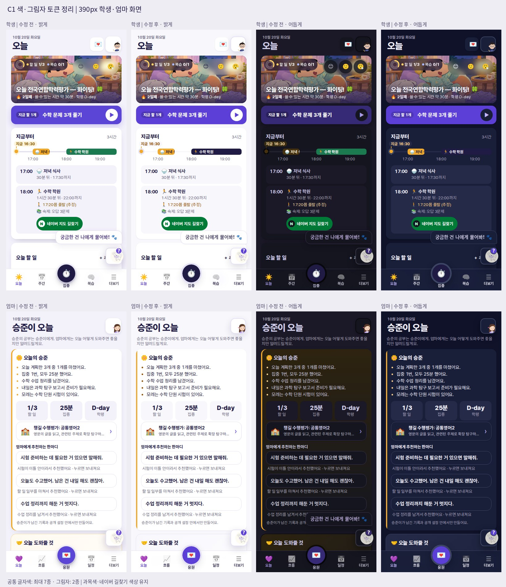

# C1 색·그림자 토큰 정리 — 검증 기록 (2026-10-20)

기준 커밋: `f009df569f12a2d9dea07eeffbf4e93176aac845` (`main`). 인계서의 C1만 적용했다.

## 변경 결과

- 공통 글자색은 `--ink`, `--ink-2`, `--ink-3`와 강조·상태 글자색으로 연결했다. 배경은 `--u-surface`, `--u-soft`, `--u-canvas`, 선은 `--u-line`으로 통일했다.
- 일반 그림자는 카드 `--sh-1`, 시트·떠 있는 요소 `--sh-2` 두 단계만 사용한다. 테두리·선택 표시에 사용하던 그림자는 outline 또는 배경 선으로 옮겨 요소 크기를 유지했다.
- 글자 강조색과 진한 배경을 구분했다. `--accent-ink`, `--ok-ink`, `--warn-ink`, `--exam-ink`는 밤 화면에서 밝아지고, 진한 버튼 배경과 그 위의 글자는 한 쌍으로 유지한다.
- 자동 밤 변환에서 명시적인 `.fc-dark` 규칙과 고정 색 역할을 다시 변환하지 않는다. 과목 8색 원본은 유지하고 기존 과목별 밤 규칙이 원본 색으로 계산되게 했다. 영어·사회·과학탐구실험 알약의 기존 대비 3.61~3.85:1 문제도 이 과정에서 해결했다.
- 시간표의 현재 교시 색을 채우던 `inset` 그림자 2곳은 같은 색·혼합 비율의 배경 레이어로 옮겼다. 과목 판별·색상 값·주간 이동 로직은 유지한다.
- 공통 CSS를 사용하는 다른 진입 HTML 7개에도 `ui-system.css`를 연결했다. 서비스 워커 캐시는 `v115-color-tokens`로 올렸다. 런타임 자산 추가는 없어 ASSETS는 기존 130개다.

## 동일 예시 데이터 전후 측정

폰 390×844, 학생, 밝은 테마. 직접 글자 노드·입력 요소의 계산된 색을 집계하고, 접힌 카드 등 렌더링되지 않은 내용은 제외했다. 하단 탐색·흰둥이 안내도 포함한다.

**공통 글자색**에서는 인계서에서 보존하도록 한 과목 알약과 네이버 길찾기 브랜드 요소를 제외한다. **전체 글자색**은 이 예외까지 포함한다. 따라서 학교 소식의 전체 9색과 밤 오늘 화면의 전체 9색은 보존된 의미·브랜드 색을 포함한 값이다. 공통 색 ≤8, 그림자 ≤2 기준은 160개 조합에서 모두 만족한다.

| 화면 | 공통 글자색 | 전체 글자색 | 그림자 |
|---|---:|---:|---:|
| 오늘 | 18 → 7 | 19 → 8 | 9 → 2 |
| 주간 | 10 → 5 | 11 → 6 | 6 → 2 |
| 학교 소식 | 13 → 6 | 16 → 9 | 5 → 2 |
| 내신 계산기 | 12 → 5 | 12 → 5 | 4 → 2 |
| 기말 플랜 | 16 → 6 | 16 → 6 | 4 → 2 |
| 복습 | 11 → 5 | 11 → 5 | 6 → 2 |
| 나의 기록 | 16 → 6 | 16 → 6 | 6 → 2 |
| 설정 | 9 → 5 | 9 → 5 | 5 → 2 |
| 내 교과서 | 9 → 5 | 9 → 5 | 4 → 2 |
| 시험·과제 | 8 → 5 | 8 → 5 | 6 → 2 |

인계서의 수치와 이번 전후 수치는 예시 데이터·일시적 안내 표시 여부에 따라 다를 수 있다. 위 표는 같은 데이터·측정 코드·브라우저 환경으로 다시 측정한 결과다.

## 검증 범위와 결과

- 10개 화면 × 4개 폭(360·390·820·1180px) × 2개 역할(학생·엄마) × 2개 테마 = **160개 조합**.
- 공통 글자색 최대 **7종**, 일반 그림자 최대 **2종**. 가로 넘침 **0건**, JavaScript 페이지 오류 **0건**.
- 직접 계산할 수 있는 단색 배경의 글자 대비 검사: **기준 미달 0건**. 기준은 일반 글자 4.5:1, 큰 글자 3:1이다. 사진·그라데이션 위 글자는 자동 계산 대상에서 제외하고 캡처를 확인했다. 이 결과는 전체 접근성 인증을 의미하지 않는다.
- 실제 브라우저에서 키보드 스페이스로 할 일 완료·저장, 할 일 추가 양식 저장, 주 경계를 넘는 방향키 이동, 주 단위 버튼 이동, 터치 밀기, 테마 왕복, 동작 줄이기, 실제 엄마 역할 전환과 학생 할 일 읽기 전용 상태를 확인했다.
- 동반 진입 화면 `index.html`, `know-me.html`, `today.html`, `hub.html`, `future.html`, `login.html`, `parent.html`의 토큰 로딩을 확인했다.
- `node future-compass/scripts/check.mjs` 및 `check-*.cjs` 4개·`check-*.mjs` 5개 모두 통과. `git diff --check` 통과.
- 기능·문구·localStorage 키를 유지한다. C2~C7의 별도 UI 변경은 포함하지 않는다.

테스트는 고정 날짜 `2026-10-20 16:30 KST`와 별도 브라우저 저장소의 예시 데이터로 수행했다. 외부 요청을 차단한 로컬 정적 서버에서 확인했으며, 라이브 가족 데이터·메시지 전송·서버 동기화는 사용하지 않았다. 캡처에는 로컬 Pretendard·Noto CJK·Noto Emoji를 사용했으며 태블릿 장식 서체는 컨테이너의 대체 서체로 표시될 수 있다.

## 재현

`playwright`와 Chromium이 설치된 환경에서 저장소 루트에서 실행한다. 앱 의존성은 추가하지 않았다.

```bash
C1_AUDIT_DIR=/tmp/c1-audit-after node future-compass/scripts/audit-color-tokens.cjs after 360,390,820,1180
node future-compass/scripts/check.mjs
for script in future-compass/scripts/check-*.cjs future-compass/scripts/check-*.mjs; do node "$script" || exit; done
```

기준 소스를 별도 경로로 준비하면 `C1_DIST=/기준소스/future-compass/dist`를 지정해 같은 예시 데이터를 측정할 수 있다. 설치한 Chromium 경로는 `C1_CHROMIUM`, Playwright 모듈 경로는 `C1_PLAYWRIGHT_MODULE`, 선택적 Pretendard WOFF2 경로는 `C1_AUDIT_FONT`로 지정한다.

- [200개 전후 측정 행 CSV](c1-color-token-metrics-20261020.csv)
- [학생·엄마 밝게·어둡게 비교 이미지](c1-color-tokens-preview-20261020.jpg)


