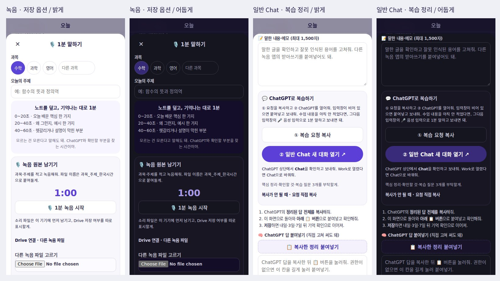

# 1분 복습 · 일반 Chat · 녹음 원본 저장 검증

**상태: 검토용 구현. 실제 Google 계정의 자동 저장은 미연결.** ChatGPT의 Chat/Work 모드를 외부에서 강제 전환하는 공식 방법은 확인되지 않아, 일반 Chat 새 대화 링크와 모드 확인 안내를 제공한다.

## 바뀐 동작

기존 화면은 실제 녹음 버튼 없이 녹음 내용을 붙여넣도록 안내했고, 긴 요청은 1,300/1,800자에서 잘렸다. 복사 실패도 성공으로 표시했으며, ChatGPT 답이 자동으로 붙는다고 안내했다. 수업 내용을 아직 입력하지 않고 ChatGPT로 나간 초안은 복구되지 않았다.

이제 과목·주제를 정해 실제 음성 파일을 녹음하고, 가능한 브라우저에서는 받아쓰기도 함께 시도한다. 음성 원본은 IndexedDB에 보관한다. Google 연결 후에는 선택한 폴더의 과목별 하위 폴더에 `과목_주제_한국시간_KST.실제확장자`로 저장하고, Drive 파일을 다시 조회해 확인한 뒤 완료로 표시한다. 불러온 외부 녹음 파일은 불러온 시각을 파일명에 사용한다.

복습 요청은 1,500자 원문 전체를 포함한다. 요청을 복사한 뒤 일반 Chat 새 대화를 열며, ChatGPT에서 Chat 선택을 확인한다. 답은 직접 붙여넣어 저장한다. 핵심·용어·확인할 것·질문 3개를 구분하고, 내일·3일·7일 기억 확인으로 연결한다. 녹음 원본을 듣거나 내려받고, 내보낸 Markdown에서도 정리와 녹음 참조를 확인할 수 있다.

## 변경 파일

| 파일 | 역할 |
|---|---|
| `dist/audio-vault.js` | MediaRecorder, 중간 조각/완료 파일 기기 보관, 재생·받기, Drive OAuth/Picker/폴더/업로드/재시도 |
| `dist/talk-note.js` | 과목·주제, 1분 회상 안내, 받아쓰기, 요청 복사·Chat·답 붙여넣기, 초안·복습·녹음 참조 |
| `dist/shiro-ai.js` | 일반 Chat 전용 링크, 긴 원문 전달, 복사 성공 확인과 수동 복사 대안 |
| `dist/review-recall.js` | 확인 질문·핵심·용어를 Markdown/확인할 것과 구분해서 읽기 |
| `dist/study.html`, `dist/sw.js` | 녹음 모듈 로딩, 캐시 v116, ASSETS 131개 |
| `netlify/functions/recording-config.mjs` | 공개 OAuth 클라이언트/Picker 설정만 노출 |
| `scripts/check-recording-config.mjs` | 미설정 상태·비밀키/토큰 미노출 확인 |
| `scripts/audit-audio-vault.cjs` | 실제 인코딩과 모의 Google 연결·업로드·복구 검증 |
| `scripts/audit-talk-note.cjs` | 실제 앱에서 복습 전달·저장·원본 재생·반응형 확인 |
| `docs/one-minute-recording-setup.md` | 운영 OAuth 설정과 확인 방법 |

기존 localStorage 키를 유지했다. 녹음 Blob은 별도 IndexedDB `fc-study-audio`, 폴더 선택 정보는 기기별 `fc-audio-drive-v1`을 사용한다. OAuth 토큰은 페이지 메모리에만 보관한다.

## 확인 결과

- 기존 `check.mjs`와 `check-*.cjs/.mjs` 전부 통과. 공개 Google 설정의 비밀키 미노출 검사도 통과.
- 실제 Chromium의 가상 마이크와 MediaRecorder로 WebM 바이트를 생성했다. EBML 헤더, 60초 타이머 종료, 실제 MIME 확장자, 한국시간 파일명, 새로고침 후 Blob의 크기·이름 보존을 확인했다. 테스트 음성은 실제 사용자 음성이 아니다.
- Google Identity·Picker·Drive API를 모의 응답으로 검증했다. `drive.file` 권한, 선택한 루트와 과목별 부모 폴더, 업로드 바이트 수, 파일 정보 재조회, 응답 유실 후 새로고침·재시도에서 같은 ID 사용과 중복 생성 방지를 확인했다.
- Google 승인 거부, 마이크 거부, 늦게 도착한 마이크 권한 결과의 트랙 해제, 액세스 토큰의 localStorage 미저장을 확인했다.
- 빈 수업 내용으로 ChatGPT 이동 후 초안 복구, 요청 전체 복사, 권한 거부 시 직접 복사/붙여넣기, 보낸 요청의 잘못된 붙여넣기 차단, 긴 정리의 무음 잘림 방지, 작성 중 답 덮어쓰기 방지, 선택한 복습 날짜 복구, 저장 공간 실패 후 재시도를 확인했다.
- 음성 파일 가져오기 → 노트의 과목·주제·녹음 참조 → 원본 재생·파일 받기 → 정리와 녹음 참조의 Markdown 내보내기를 확인했다.
- 360·390·820·1180px × 밝게·어둡게 × 옵션 2상태 **16조합**에서 가로 넘침, 44px 미만 사용자 컨트롤, 12.5px 미만 글자, JavaScript 페이지 오류 0건. 키보드 초점 순환과 엄마/잠금 상태에서 학생 초안을 열지 않는 것도 확인했다.

## 아직 실계정에서 확인할 것

1. 웹앱용 `GOOGLE_DRIVE_CLIENT_ID`, `GOOGLE_DRIVE_API_KEY`, `GOOGLE_DRIVE_PROJECT_NUMBER`를 설정하고 해당 원본을 Google Cloud에 등록한다. 현재 작업 환경에 이 값들이 없으며, ChatGPT 플러그인 인증을 추출·재사용하지 않았다.
2. 앱에서 Google 계정을 승인하고 준비한 `승준 공부방/1분 복습 녹음` 폴더를 Picker로 선택한다. 실제 휴대폰에서 녹음한 파일을 Drive에서 열어 소리를 확인한다.
3. 실제 휴대폰의 ChatGPT에서 링크가 열리는 방식과 Chat 선택을 확인한다. 외부 링크 테스트는 URL과 전달 원문까지만 검증했으며, ChatGPT 계정의 모드 선택·실제 응답 품질을 자동 검증했다고 주장하지 않는다.

인계 절차에 따라 별도 PR로 검토한다. C1 색 토큰 PR과 합치지 않는다. 두 PR의 `sw.js` 캐시 버전은 최종 병합 순서에 맞춰 한 번 정리해야 한다.

