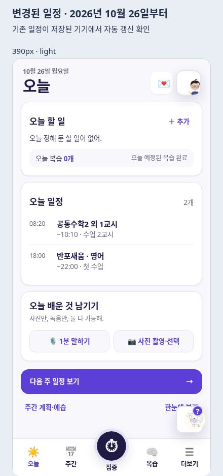

# 변경된 최종 시간표 적용 — 2026-10-26

사용자가 제공한 이미지와 ‘변경된 일정이므로 이것으로 반영’이라는 확인을 기준으로, 기존 일정에 추가하는 대신 앞으로의 반복 일정을 교체한다. 이미지의 10/15 목요일·10/21 수요일·10/26 월요일이 일치하는 2026년을 적용했다. 원본 이미지는 저장소에 넣지 않았다.

| 요일 | 일정 | 시간 | 원문 시작일 |
| --- | --- | --- | --- |
| 월 | 반포새움 영어 | 18:00–22:00 | 2026-10-26 |
| 화·목 | 다원교육 대치 수학 | 18:00–22:00 | 2026-10-15 |
| 수 | 송림 국어 (체리) | 16:00–19:00 | 2026-10-21 |
| 금 | PT | 18:00 시작, 종료 미정 | 별도 날짜 없음 |
| 토 | 송림 국어 클리닉 | 19:00 시작, 종료 미정 | 별도 날짜 없음 |

새 시간표는 10/26부터 적용한다. 기존 일요일 송림 영어와 토요일 탑클래스 과학은 이후 일정에서 제외한다. 원문에 없는 클리닉·PT 종료 시간은 입력하지 않는다. 새 클리닉도 10/26 이후 토요일부터 표시한다.

## 기존 기기의 기록 갱신

- `schedule-update.js`가 기존 기본값 처리와 가족 공유 첫 받기가 끝난 뒤 한 번 적용한다. 이미 사용 중인 기기도 새 앱을 열면 갱신된다.
- 이전 학원 일정은 `until: 2026-10-25`, 새 반복 일정은 `effectiveFrom: 2026-10-26`으로 구분한다. 국어·수학의 원래 수강 시작일은 유지한다. 과거의 별도 변경 기록도 이전 일정 ID에 남겨, 새 일정의 요일·시간을 덮지 않게 한다.
- 이전 수업·진도·숙제는 보존한다. 같은 학원의 국어·수학 정보는 새 일정에 유지하고, 다른 학원으로 바뀐 영어는 예전 송림의 주소·전화·좌표·진도·숙제를 새움에 추정하여 넣지 않는다.
- 저장 전 학원/일상 원본을 기기에 백업한다. 두 저장소 및 완료 표시 중 어느 단계에서 실패해도 원복하고 다음 시도 때 다시 적용한다.
- 기기별 완료 표시와 공유 데이터의 적용 버전을 함께 사용한다. 다른 기기가 먼저 갱신했거나 사용자가 이후에 수정·삭제한 항목을 반복해서 되살리지 않는다. 예전 기본값 초기화도 새 시간표에 덧씌우지 않는다.
- 현재 학원 목록은 새 4개 일정만 보이고, 이전 일정은 ‘이전 학원 일정 기록’에서 접어 둔다. PT도 금요일에 한 번만 표시한다.

## 확인

- 저장소 루트에서 `check.mjs`와 모든 `check-*.mjs`/`check-*.cjs`, **17/17 통과**.
- 새 회귀 검사: 요일·시작일·첫/마지막 날짜, 기존/빈/공유 기기, 이전 일요일 영어·토요일 과학 제외, 과거 조회, 구 시간표의 미래 변경 격리, 메모 보존, 옛 영어 주소/숙제 비복사, 미정 종료 시간, 갱신 중 실패/재시도, 잠금 화면 무변경, 가족 받기 대기, 다른 탭의 갱신 후 재표시, 수동 수정 보존.
- 실제 `FC_ACADEMY`, `FC_LIFE`, `TodayView`, 주간 일정 및 서버 수업 전 알림 계획이 같은 일정으로 계산되는지 검사했다. 알림은 발송하지 않았다.
- 격리된 실제 앱 미리보기에서 월요일 반포새움 18–22시, 화요일 수학 18–22시, 수요일 국어 16–19시, 금요일 PT 18시, 토요일 클리닉 19시·종료 미정, 일요일 학원 없음 확인.
- 390px 밝게/어둡게 화면에서 기존 기록 자동 갱신을 확인했다. 외부 API·가족 서버·주소 조회는 차단한 예시 기기를 사용했다.
- `study.html`과 `today.html`에 갱신 모듈을 연결했다. 오늘 한눈에에도 PT를 표시하고, 가족 요약의 일상 일정은 선택 필드로 검증한다.
- 서비스워커 캐시 `future-compass-20261026-v129-schedule`, 새 모듈 포함 140개 자산.

