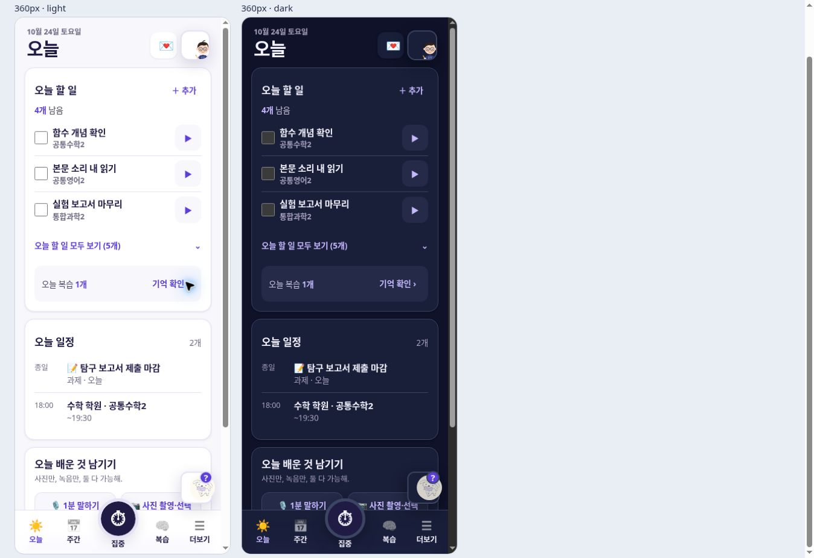
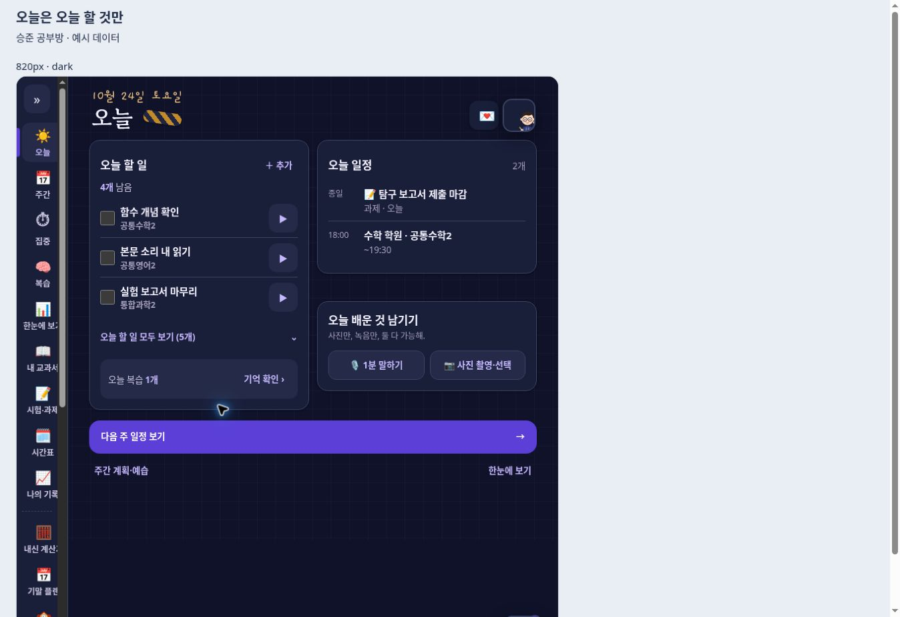
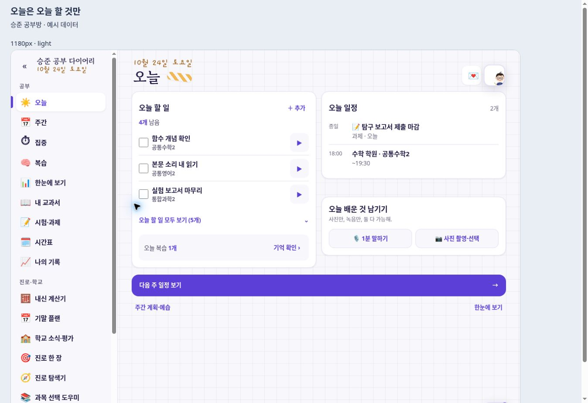
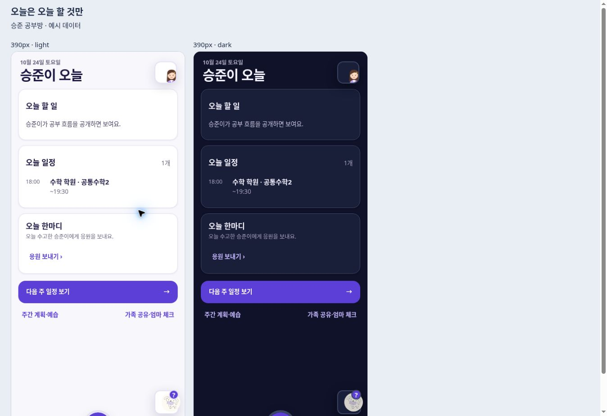

# 오늘 화면 정리 — 2026-10-24

오늘 탭이 여러 배너·내일 예습·다가오는 시험·주간 통계·밀린 할 일과 접힌 카드 묶음으로 길어졌다. 오늘 날짜에 필요한 내용만 세 카드로 제한한다.

| 위치 | 표시 기준 |
| --- | --- |
| 오늘 할 일 | 한국 날짜로 오늘에 계획된 일만, 미완료 우선·기존 중요도 순. 처음에는 최대 3개, 나머지와 완료 항목은 오늘 목록 안에서만 펼침 |
| 오늘 복습 | 오늘로 예약된 미완료 복습만, 같은 노트 중복 제거. 기억 확인 버튼은 기존 복습 창으로 연결 |
| 오늘 일정 | 오늘 수업·학교 행사·학원·일상·시험/제출일만, 처음에는 최대 3줄. 다른 날 계획했어도 제출일이 오늘인 할 일은 오늘 마감으로 표시 |
| 오늘 수업 기록 | 1분 말하기 / 사진 촬영·선택 두 버튼. 기존 사진 단독·녹음과 사진·채팅/Drive 전달 흐름 유지 |
| 하단 | 다음 **달력 주 월요일**로 바로 이동. 주간 계획·예습과 한눈에 보기 링크 |

내일 예습, 사진에서 확인한 마지막 쪽을 잇는 예습은 주간 화면의 ‘주간 계획·저녁 예습’ 안에 있다. 기존 부모 현황판과 엄마 체크는 별도 `#family` 화면으로 옮겼고 오늘 하단에서 연다. 엄마의 오늘에는 수정 버튼이 없으며 흐름·시험·복습 공개 설정을 따로 적용한다. 오늘 도착한 응원 한 줄은 유지한다. 저장 키나 원본 기록은 변경하지 않는다.

구현은 마지막 렌더 단계 `today-focus.js`가 오늘 콘텐츠를 명시적으로 구성한다. 다른 탭에서는 해제된다. `FC_WEEK.open()`이 선택 날짜를 바꾸며 주간 계획도 같은 주로 맞춘다. 주간 계획 안의 기존 이전/다음 주 버튼은 재렌더로 초기화하지 않는다.

## 검증

- 저장소 루트에서 `check.mjs`와 모든 `check-*.mjs`/`check-*.cjs`, 총 16개 실행 파일 통과.
- 새 회귀 검사: 한국 날짜 경계·오늘 날짜 필터·완료/취소/미래 기록 제외·중요도·세 줄 제한·중복 복습·완료 영속화·조회 시 무변경·월요일/일요일/연말 다음 주 계산·주간 이동·휴업일/주말·독립 공개 범위·HTML 이스케이프.
- 실제 앱 소스로 만든 격리 미리보기: 오늘 추가 창에서 입력 저장, 완료 표시, 오늘 복습 창, 사진 창의 촬영/선택, 다음 주 10/26 월요일 이동, 주간 예습 표시, 부모 비공개 및 가족 메뉴 이동 확인.
- 사진·마이크·Drive 전송 자체는 이번 UI 검증에서 실행하지 않았다. 기존 관련 회귀 검사는 통과했다. 예시 데이터만 사용하고 외부 API 호출은 차단했다.
- 새 JS/CSS 서비스워커 목록에 포함. 캐시 `future-compass-20261024-v128-today-focus`, 총 139개 자산.

| 폭 | 결과 |
| --- | --- |
| 360 | 세 카드, 내용 높이 약 985px, 가로 넘침 없음. 오늘 영역 12.5px 미만 텍스트·44px 미만 버튼/요약/체크 라벨 0 |
| 390 | 밝게/어둡게, 세 카드·촬영/선택 버튼·추가/완료·복습 확인 |
| 820 | 어두운 화면 2열, 내용 높이 약 632px, 가로 넘침 없음 |
| 1180 | 밝은 화면 2열, 내용 높이 약 650px, 세 카드와 다음 주 버튼 동시 표시 |
| 부모 390 | 밝게/어둡게, 비공개 할 일/시험/복습 숨김, 학원 일정과 응원 및 가족 체크 진입 유지 |

캡처는 실제 앱에 예시 데이터를 넣은 화면이다.

