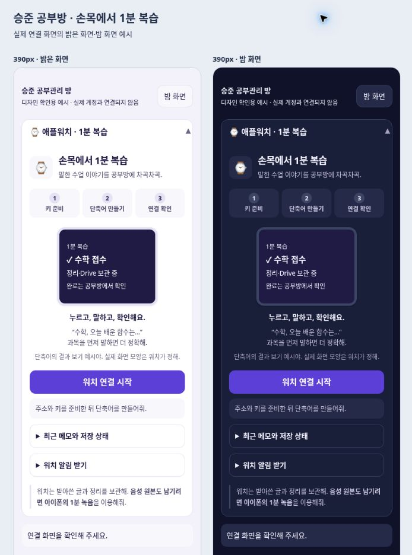
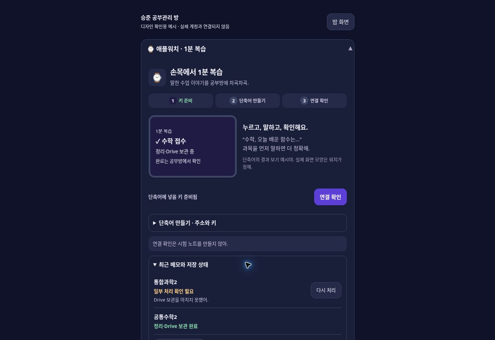

# 애플워치 1분 복습: 저장 복구와 연결 화면

작성일: 2026-10-22 (한국 시간). 기준: main `c6d303d`, PR #221 후속 작업.

워치 단축어에서 받은 말을 잃지 않고 공부방 노트·복습 일정·Drive 처리 결과로 이어지게 한다. 아이폰의 연결 화면은 **키 준비 → 단축어 만들기 → 연결 확인**으로 정리했다. 실제 워치에서는 단축어의 받아쓰기와 결과 보기를 사용한다.

## 저장 동작 수정

| 상황 | 변경 후 |
| --- | --- |
| 기기 저장 공간 부족 | 노트·복습 메모·복습 날짜를 모두 저장한 뒤 수신 확인(ACK). 실패하면 세 저장소를 되돌리고 서버에서 다시 가져올 수 있게 유지 |
| 응답 유실·중복 가져오기 | 외부 ID와 처리 결과 시각으로 이미 저장한 결과 확인. 노트·복습 항목 중복 방지 |
| 서버 재시작 | 워치 원문을 작업 JSON에 먼저 저장. 진행 중 작업은 재시작 때 자동 재개. 원문 없는 구버전 작업은 ‘중단’으로 표시 |
| 정리·Drive 일부 실패 | 완료·일부 실패·실패·중단 구분. 보관된 원문으로 다시 처리하며, 확인된 업로드와 정리는 재사용 |
| 재처리 결과 도착 | 학생이 고친 원문·정리·복습 메모와 직접 바꾼 복습 날짜 유지. 새 Drive 결과만 보완 |
| 다음 날 앱 열기 | 말한 시각의 한국 날짜로 노트와 1·3·7일 복습 계산. 10/21 23:59에 말하면 10/22·24·28 복습 |
| 엄마 티켓으로 원문 조회 | `/watch/inbox`와 Watch 작업의 `/voice?id=…` 조회 모두 학생 역할만 허용. 설정·시간표·확인·끄기·ACK·재처리도 동일 |
| 오래된 중단 작업이 많은 경우 | 완료된 메모부터 가져오고, 수신 확인 뒤 다음 묶음을 가져옴 |

서버는 원문 저장에 실패하면 접수 성공을 반환하지 않는다. 키·수신 확인 목록 저장 실패도 성공으로 처리하지 않는다. 기존 localStorage 키와 서버 작업 파일 형식은 유지하고 메타데이터만 추가했다.

## 화면과 사용법

1. 승준 화면에서 **설정 → 애플워치 → 워치 연결 시작**.
2. 아이폰 단축어 앱에서 ‘1분 복습’을 만든다. 한국어 텍스트 받아쓰기 → URL의 콘텐츠 가져오기(POST/JSON, `key`와 `text`) → 결과 보기. 앱 안에 주소·키 복사와 5단계 안내가 있다.
3. ‘Apple Watch에서 보기’를 켜고 워치 단축어 앱에서 실행한다. 원하는 워치 페이스가 지원하면 단축어 컴플리케이션으로 배치한다.
4. 공부방에서 **연결 확인**으로 키와 서버를 검사한다. 이 검사는 노트를 만들지 않는다. 실제 워치에서 ‘수학, 오늘 배운 함수는…’처럼 한 번 말해본다.
5. 워치는 아래 접수 안내를 보여준다. 최종 결과는 공부방의 **최근 메모와 저장 상태**에서 확인한다. 일부 실패라면 이유를 보고 **다시 처리**, 기기 저장 실패라면 **다시 가져오기**.

```text
✓ 공통수학2 접수
정리·Drive 보관 중
완료는 공부방에서 확인
```

설정 바로가기로 독립된 워치 항목을 펼친다. 최근 상태·알림·키 관리는 접어서 두고, 키는 기본적으로 가린다. 갱신 때 펼침 상태와 키보드 초점을 유지한다. 작은 폰은 안내 예시를 한 열로 배치하며, 앱의 색·글자·버튼 토큰을 사용한다.

Watch 경로는 **받아쓴 글과 정리**를 보관한다. 음성 원본이 필요하면 아이폰의 1분 녹음을 이용한다. Drive 폴더는 `승준 공부방/1분 복습 녹음/과목`, 파일명은 기존의 과목·주제·한국 시각 규칙을 따른다. 작업 원문·결과의 서버 보관 기한은 기존과 같은 48시간이다.





캡처는 실제 변경 스크립트·스타일을 예시 계정 통신으로 실행한 화면이다. 워치 접수 예시는 설명용이며 실제 단축어 결과 화면의 글꼴·배치는 watchOS가 결정한다.

## 검증 결과

- `scripts/check.mjs`와 모든 `check-*.mjs/.cjs`: 총 15개 검사 진입점 통과. `check-know-me.cjs`는 저장소 루트에서 실행한다.
- 새 `check-watch-recovery.mjs`는 `check.mjs`에 포함: 실제 브라우저 소스를 VM에서 실행하여 세 저장소의 각 쓰기 실패·중복·ACK 응답 유실·역할 전환·날짜·편집 보존을 검사한다.
- 서버 검사: 외부 서비스 없는 임시 디렉터리·로컬 HTTP 서버에서 티켓 역할, 접수 문구, 키 해시, 재처리, 20개 초과 수신함을 검사한다. 원문 저장 실패·처리 중 디스크 실패·정리 중 재시작·Drive 중 재시작·일부 업로드 재시도도 재현했다.
- UI: 실제 공부방 전체의 예시 화면에서 360·390·820·1180px, 밝게·어둡게 확인. 워치 카드의 가로 넘침 0, 보이는 조작 영역 44px 미만 0. 390px에서 12.5px 미만 글자 0. 클래식 스크롤바 때문에 내부 문서 폭은 지정 폭보다 15px 좁다.
- 키 가리기·펼친 안내 유지·키보드 초점·노트 없는 연결 확인, 엄마 화면의 워치 카드와 바로가기 비노출 확인. 주요 안내·상태 글자와 버튼의 밝은 화면 대비는 5.29:1 이상.
- `sw.js`: `future-compass-20261022-v126-watch-recovery`; 새 `watch-link.css` 캐시 포함(전체 136개 자산).

## Claude 검토·배포 확인

PR 검토 후 기존 배포 절차로 VPS와 Netlify 양쪽을 반영한다. PR 미리보기는 VPS의 새 API까지 배포하지 않는다. 새 `/watch/check`·`/watch/retry`는 VPS 배포 후 사용할 수 있다.

배포 완료 판단은 카드 존재만으로 하지 않는다. 프론트 `watch-link.js`·`watch-link.css`·`talk-note.js`와 서비스워커 버전, VPS 실제 배포 커밋을 확인한 뒤 학생 계정에서 ‘연결 확인’을 실행한다. Netlify 상태의 `success`라도 설명이 `Deploy Preview canceled.`면 미리보기 성공으로 기록하지 않는다.

실제 Apple Watch에서 받아쓰기 → 결과 보기 → 공부방 가져오기 → Drive 링크 열기, 아이폰 잠금 상태 알림 미러링은 장비 검증이 남아 있다. 단축어 작업 지원 여부와 알림·집중 모드는 실제 기기에서 확인한다.

참고: [Apple Watch 단축어](https://support.apple.com/guide/watch/shortcuts-apd99050d435/watchos), [watchOS 디자인](https://developer.apple.com/design/human-interface-guidelines/designing-for-watchos), [Apple Watch 알림](https://support.apple.com/en-us/108369).
